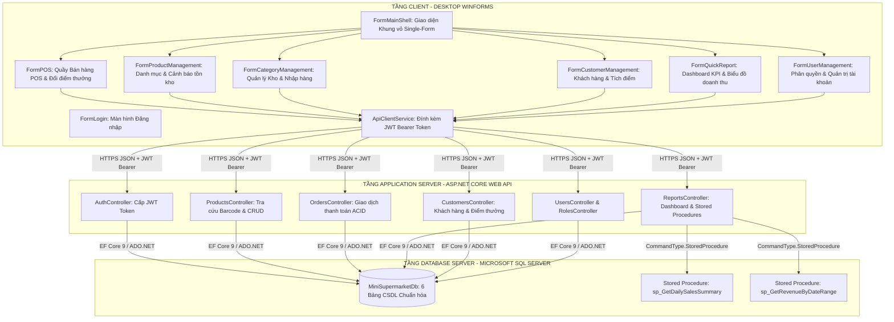
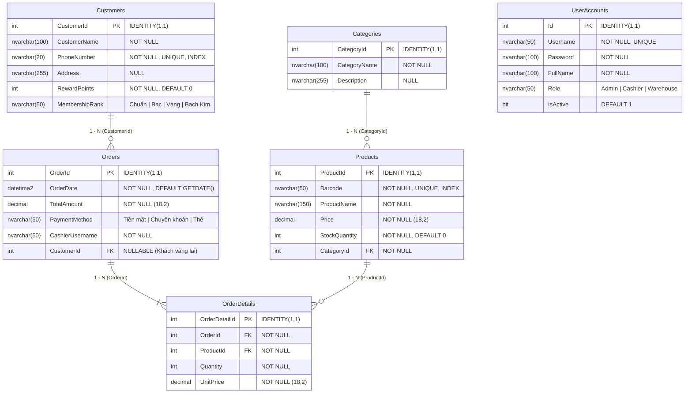
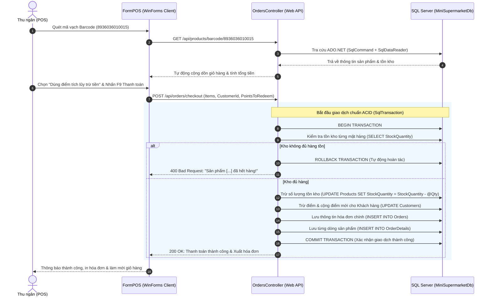

# ĐỒ ÁN: NGHIÊN CỨU VÀ HIỆN THỰC HÓA HỆ THỐNG QUẢN LÝ BÁN LẺ VÀ TỒN KHO THEO KIẾN TRÚC CLIENT-SERVER (RESTFUL API & WINFORMS)
### ỨNG DỤNG CHO HỆ THỐNG SIÊU THỊ MINI & BÁN LẺ CÔ BA SÀI GÒN

---

<p align="center">
  
  
  
  
  
  
  
  
</p>

---

## 📌 THÔNG TIN TÁC GIẢ & HỌC PHẦN
- **Họ và tên sinh viên:** Nguyễn Tấn Điệp
- **Mã số sinh viên (MSSV):** 2123110145
- **Lớp học phần:** CCQ2411C
- **Học phần:** Lập trình ứng dụng (LTUD)
- **Nền tảng công nghệ:** .NET 9.0 / C# / ASP.NET Core Web API / Entity Framework Core 9 / ADO.NET thuần / Windows Forms / Microsoft SQL Server
- **Mã nguồn dự án:** [https://github.com/TanDiep1004/TanDiep_LTUD](https://github.com/TanDiep1004/TanDiep_LTUD)

---

## 📑 MỤC LỤC HỆ THỐNG
1. [Chương 1: Tổng quan đề tài & Cơ sở lý thuyết nền tảng](#-chương-1-tổng-quan-đề-tài--cơ-sở-lý-thuyết-nền-tảng)
2. [Chương 2: Lộ trình 5 Buổi thực hành & Tiến độ phát triển](#-chương-2-lộ-trình-5-buổi-thực-hành--tiến-độ-phát-triển)
3. [Chương 3: Bảng kiểm tra toàn diện 48 Tiêu chí Đồ án (Rubric 1 – 48)](#-chương-3-bảng-kiểm-tra-toàn-diện-48-tiêu-chí-đồ-án-rubric-1--48)
4. [Chương 4: Thiết kế Kiến trúc & Cơ sở dữ liệu](#-chương-4-thiết-kế-kiến-trúc--cơ-sở-dữ-liệu)
5. [Chương 5: Hệ thống Phân quyền Người dùng (RBAC Matrix)](#-chương-5-hệ-thống-phân-quyền-người-dùng-rbac-matrix)
6. [Chương 6: Hướng dẫn Cài đặt & Triển khai Hệ thống](#-chương-6-hướng-dẫn-cài-đặt--triển-khai-hệ-thống)
7. [Chương 7: Kịch bản Kiểm thử Chức năng (Demo & Test Cases)](#-chương-7-kịch-bản-kiểm-thử-chức-năng-demo--test-cases)
8. [Chương 8: Đánh giá Kết quả & Hướng phát triển](#-chương-8-đánh-giá-kết-quả--hướng-phát-triển)

---

## 📖 CHƯƠNG 1: TỔNG QUAN ĐỀ TÀI & CƠ SỞ LÝ THUYẾT NỀN TẢNG

### 1.1. Tính cấp thiết, Mục tiêu & Phạm vi nghiên cứu
- **Bối cảnh & Tính cấp thiết:** Tại các chuỗi bán lẻ và siêu thị mini hiện đại (điển hình như hệ thống bán lẻ *Cô Ba Sài Gòn*), việc quản lý hàng nghìn mặt hàng, nhóm hàng, thẻ thành viên khách hàng và lưu lượng thanh toán giờ cao điểm đòi hỏi một hệ thống phần mềm hoạt động ổn định, bảo mật, tra cứu siêu tốc và thống kê doanh thu tức thời. Việc quản lý bằng sổ sách hoặc ứng dụng đơn tầng truyền thống dễ dẫn đến mất mát dữ liệu, đơ ứng dụng khi quét mã vạch và không kiểm soát được quyền hạn giữa Thu ngân, Quản lý và Thủ kho.
- **Mục tiêu đề tài:**
  1. Xây dựng hoàn chỉnh phần mềm theo kiến trúc **Client-Server 3 lớp**, phân tách tuyệt đối giữa tầng giao diện người dùng Desktop (**Windows Forms**) và tầng máy chủ xử lý nghiệp vụ trung tâm (**ASP.NET Core RESTful Web API**).
  2. Thiết kế và chuẩn hóa cơ sở dữ liệu quan hệ trên **Microsoft SQL Server** với 6 thực thể cốt lõi (`UserAccounts`, `Categories`, `Products`, `Customers`, `Orders`, `OrderDetails`) cùng 2 Stored Procedures tối ưu.
  3. Hiện thực cơ chế an toàn thông tin bằng **JWT (JSON Web Token)**, phân quyền theo vai trò **RBAC (Role-Based Access Control)** ở cả 2 tầng API và UI, đồng thời bảo đảm toàn vẹn giao dịch thanh toán quầy POS theo chuẩn **ACID** qua `SqlTransaction`.
- **Phạm vi nghiên cứu:** Phục vụ chu trình vận hành bán lẻ khép kín: Quản trị tài khoản & phân quyền, Quản lý kho & cảnh báo hết hàng, Quản lý danh mục & giá bán, Quản lý khách hàng thân thiết tích điểm, Quầy thu ngân POS quét mã vạch barcode, Đổi điểm thưởng trừ tiền và Báo cáo phân tích doanh thu ca bằng biểu đồ trực quan.

### 1.2. Cơ sở lý thuyết nền tảng
1. **Nền tảng .NET 9 & Ngôn ngữ C# 13:**
   - **CLR (Common Language Runtime):** Tự động thu dọn vùng nhớ (Garbage Collection), tối ưu hóa bộ nhớ RAM, kiểm tra an toàn kiểu dữ liệu.
   - **Lập trình bất đồng bộ (`async` / `await`):** Áp dụng 100% trong tất cả Controller API và sự kiện WinForms, giải phóng luồng xử lý UI thread khi gọi mạng hoặc truy vấn CSDL, loại bỏ hoàn toàn tình trạng treo giao diện (*Not Responding*).
2. **Kiến trúc RESTful Web API & Định dạng JSON:**
   - Giao tiếp phi trạng thái (*Stateless*) qua giao thức HTTP chuẩn: `GET` (Đọc dữ liệu), `POST` (Tạo mới), `PUT` (Cập nhật), `DELETE` (Xóa) kèm các mã trạng thái HTTP chuẩn (`200 OK`, `201 Created`, `400 Bad Request`, `401 Unauthorized`, `403 Forbidden`, `404 Not Found`).
   - Dữ liệu trao đổi được đóng gói chặt chẽ qua các lớp **DTO (Data Transfer Object)**, ngăn ngừa lộ mật khẩu và các trường nội bộ của Database.
3. **Kết hợp Entity Framework Core 9 & ADO.NET thuần:**
   - **EF Core 9:** Sử dụng Code-First, Migration tự động, LINQ query tối ưu với `.Include()` (Eager Loading) và `.AsNoTracking()` (truy vấn chỉ đọc giải phóng RAM).
   - **ADO.NET thuần:** Sử dụng `SqlConnection`, `SqlCommand`, `SqlDataReader` duyệt một chiều siêu tốc, truyền tham số an toàn bằng `cmd.Parameters.AddWithValue` chống tấn công **SQL Injection**, gọi Stored Procedure và bọc thanh toán trong `SqlTransaction` có hỗ trợ `Rollback()`.
4. **Cơ chế Bảo mật JWT & Phân quyền RBAC:**
   - Xác thực danh tính người dùng bằng chuỗi Token JWT có chữ ký điện tử `HMAC-SHA256` chứa Claims `ClaimTypes.Name` và `ClaimTypes.Role`.
   - Phân quyền theo vai trò 3 cấp: **Admin** (Quản trị viên toàn quyền), **Cashier** (Thu ngân quầy POS & Khách hàng), **Warehouse** (Thủ kho quản lý nhập hàng & danh mục).
5. **Mô hình Giao diện Windows Forms Single-Form Shell Pattern:**
   - Bố cục giao diện cố định 3 vùng: Menu Sidebar trái, Header trên cùng, Vùng làm việc chính `panelMainContent` ở giữa.
   - Các Form chức năng con được nhúng trực tiếp (`TopLevel = false`, `FormBorderStyle = None`, `Dock = Fill`), chuyển đổi màn hình mượt mà không bị giật lag.

---

## 🚀 CHƯƠNG 2: LỘ TRÌNH 5 BUỔI THỰC HÀNH & TIẾN ĐỘ PHÁT TRIỂN

Dự án được phân chia và hiện thực theo đúng tiến độ **5 Buổi thực hành chuyên sâu** của học phần Lập trình ứng dụng (LTUD):

| Buổi | Tên cột mốc / Nội dung phát triển | Trọng tâm công nghệ | Kết quả nghiệm thu |
| :---: | :--- | :--- | :--- |
| **Buổi 1** | **Khởi tạo Kiến trúc Dự án & Xác thực Đăng nhập** | .NET 9 Solution, REST API, WinForms, JWT, Model UserAccounts | Xây dựng Solution 2 project (`MiniSupermarket.API` và `MiniSupermarket.WinForms`), cấu hình CORS, mã hóa mật khẩu, cấp mã JWT Token và Form Đăng nhập giao diện phẳng. |
| **Buổi 2** | **Xây dựng Core Web API & Quản lý Danh mục, Sản phẩm, Khách hàng** | ASP.NET Core Controllers, DTOs, LINQ Queries, CRUD Endpoints | Xây dựng hoàn chỉnh các Controller: `CategoriesController`, `ProductsController`, `CustomersController`; định dạng JSON DTO tách biệt, tìm kiếm và lọc dữ liệu. |
| **Buổi 3** | **Kết nối SQL Server, EF Core Code-First & Tối ưu Hóa Truy vấn** | SQL Server, EF Core 9 Migrations, DbContext, .Include, .AsNoTracking | Thiết kế 6 bảng CSDL, tự động chạy Migration & nạp Seed Data 15 sản phẩm mẫu; tối ưu truy vấn bằng `.AsNoTracking()`, nạp kèm bảng cha bằng `.Include()`, phân trang server-side `.Skip().Take()`. |
| **Buổi 4** | **Kiến trúc Main Shell WinForms, Phân quyền RBAC & Quầy POS ACID** | Single-Form Shell, RBAC 2 tầng, ADO.NET, SqlTransaction, Barcode | Hoàn thiện `FormMainShell` điều hướng mượt mà, phân quyền ẩn/hiện nút theo 3 vai trò (Admin, Cashier, Warehouse); Quầy POS quét mã vạch cộng dồn, thanh toán ACID bọc trong `SqlTransaction` an toàn (tự động Rollback khi kho không đủ hàng). |
| **Buổi 5** | **Báo cáo Thống kê Doanh thu, Dashboard KPI, Đổi Điểm Thưởng & Hoàn thiện Hệ thống** | Stored Procedures, GDI+ Chart, LINQ GroupBy, Low-Stock Alert, CSV Export | Báo cáo doanh thu ca gọi Stored Procedure `sp_GetDailySalesSummary` & `sp_GetRevenueByDateRange`; Vẽ biểu đồ cột doanh thu; Dashboard 4 thẻ KPI; Bảng xếp hạng Top 5 bán chạy; Đổi điểm thưởng tích lũy (RewardPoints) trừ tiền trên POS; Cảnh báo hàng tồn kho $\le$ 10 tô màu đỏ nhạt `LightCoral`; Xuất báo cáo danh mục & hóa đơn ra Excel/CSV UTF-8 BOM; Sửa lỗi co giãn khung lưới hiển thị không bị mất chữ. |

---

## ✅ CHƯƠNG 3: BẢNG KIỂM TRA TOÀN DIỆN 48 TIÊU CHÍ ĐỒ ÁN (RUBRIC 1 – 48)

Dưới đây là bảng tổng hợp toàn bộ **48 tiêu chí kỹ thuật và nghiệp vụ**, đối chiếu chi tiết giữa yêu cầu đề bài và vị trí triển khai trong mã nguồn:

| STT | Tên tiêu chí kỹ thuật & nghiệp vụ | Mô tả yêu cầu nghiệp vụ & giải pháp kỹ thuật | Vị trí mã nguồn triển khai | Trạng thái |
| :---: | :--- | :--- | :--- | :---: |
| **1** | Khởi tạo Solution .NET 9.0 | Tạo Solution gồm 2 Project độc lập: `MiniSupermarket.API` và `MiniSupermarket.WinForms`. | `MiniSupermarket.sln` | ✅ Đạt |
| **2** | Cấu hình Dependency Injection (DI) | Đăng ký `SupermarketDbContext`, HttpClient, Authentication services vào DI Container. | `MiniSupermarket.API/Program.cs` | ✅ Đạt |
| **3** | Cấu hình CORS đa môi trường | Bật chính sách CORS `AllowAll` cho phép Client Desktop/Web gọi API thông suốt. | `MiniSupermarket.API/Program.cs` | ✅ Đạt |
| **4** | Chuỗi kết nối tập trung | Cấu hình chuỗi kết nối SQL Server trong `appsettings.json`, không hard-code trong mã. | `MiniSupermarket.API/appsettings.json` | ✅ Đạt |
| **5** | Thực thể tài khoản (UserAccounts) | Tạo bảng người dùng gồm Username (Unique), Password, FullName, Role, IsActive. | `MiniSupermarket.API/Models/UserAccount.cs` | ✅ Đạt |
| **6** | Thực thể nhóm hàng (Categories) | Tạo bảng phân loại ngành hàng gồm CategoryId, CategoryName, Description. | `MiniSupermarket.API/Models/Category.cs` | ✅ Đạt |
| **7** | Thực thể sản phẩm (Products) | Tạo bảng hàng hóa gồm ProductId, Barcode, ProductName, Price, StockQuantity, CategoryId. | `MiniSupermarket.API/Models/Product.cs` | ✅ Đạt |
| **8** | Thực thể khách hàng (Customers) | Bảng thành viên gồm CustomerId, CustomerName, PhoneNumber, Address, RewardPoints, Rank. | `MiniSupermarket.API/Models/Customer.cs` | ✅ Đạt |
| **9** | Thực thể hóa đơn (Orders) | Bảng hóa đơn gồm OrderId, OrderDate, TotalAmount, PaymentMethod, CashierUsername, CustomerId. | `MiniSupermarket.API/Models/Order.cs` | ✅ Đạt |
| **10** | Thực thể chi tiết (OrderDetails) | Bảng chi tiết gồm OrderDetailId, OrderId, ProductId, Quantity, UnitPrice. | `MiniSupermarket.API/Models/OrderDetail.cs` | ✅ Đạt |
| **11** | Khóa ngoại & Quan hệ 1 - N | Thiết lập quan hệ 1-N chuẩn xác giữa Category - Products, Customer - Orders, Order - OrderDetails. | `MiniSupermarket.API/Data/SupermarketDbContext.cs` | ✅ Đạt |
| **12** | EF Core Migrations tự động | Tự động chạy lệnh `dbContext.Database.Migrate()` khi máy chủ API khởi động. | `MiniSupermarket.API/Program.cs` | ✅ Đạt |
| **13** | Database Seeding tự động | Tự động nạp dữ liệu mẫu 18 tài khoản và 15 sản phẩm tiêu biểu siêu thị mini. | `MiniSupermarket.API/Data/SupermarketDbContext.cs` | ✅ Đạt |
| **14** | Tách biệt lớp DTOs | Sử dụng các DTO chuyên biệt (`ProductDto`, `CategoryDto`, `CustomerDto`, `SaveProductDto`...). | `MiniSupermarket.API/DTOs/` | ✅ Đạt |
| **15** | Lập trình bất đồng bộ (Async/Await) | 100% các Action trên Controllers dùng `async Task<IActionResult>` và `await`. | Toàn bộ Controllers API | ✅ Đạt |
| **16** | CRUD Nhóm hàng (Categories) | API hỗ trợ đầy đủ `GetAll`, `GetById`, `Search`, `Create`, `Update`, `Delete`. | `MiniSupermarket.API/Controllers/CategoriesController.cs` | ✅ Đạt |
| **17** | CRUD Sản phẩm (Products) | API hỗ trợ đầy đủ lấy danh sách, chi tiết, thêm mới, sửa đổi và xóa sản phẩm. | `MiniSupermarket.API/Controllers/ProductsController.cs` | ✅ Đạt |
| **18** | CRUD Khách hàng (Customers) | API hỗ trợ quản lý khách hàng, tích điểm thưởng và phân hạng thành viên. | `MiniSupermarket.API/Controllers/CustomersController.cs` | ✅ Đạt |
| **19** | Quản lý Tài khoản (Users) | API hỗ trợ Admin quản lý danh sách nhân viên, đặt lại mật khẩu và đổi trạng thái kích hoạt. | `MiniSupermarket.API/Controllers/UsersController.cs` | ✅ Đạt |
| **20** | Quản lý Vai trò (Roles) | API cung cấp danh mục chức vụ: Admin, Manager, Cashier, Warehouse. | `MiniSupermarket.API/Controllers/RolesController.cs` | ✅ Đạt |
| **21** | HTTP Status Codes chuẩn REST | Trả về chuẩn xác `200 OK`, `201 Created`, `400 Bad Request`, `401 Unauthorized`, `403 Forbidden`, `404 Not Found`. | Toàn bộ Controllers API | ✅ Đạt |
| **22** | Kiểm tra dữ liệu (Validation) | Bắt buộc nhập đầy đủ dữ liệu thông qua Data Annotations và `ModelState.IsValid`. | Các Model DTOs | ✅ Đạt |
| **23** | Tìm kiếm LINQ gần đúng (.Contains) | Tìm kiếm theo tên sản phẩm, mã vạch hoặc tên khách hàng bằng LINQ `.Contains()`. | `ProductsController.cs`, `CustomersController.cs` | ✅ Đạt |
| **24** | Lọc dữ liệu kết hợp nhiều tiêu chí | Lọc đồng thời sản phẩm theo nhóm hàng (CategoryId) và từ khóa tìm kiếm. | `MiniSupermarket.API/Controllers/ProductsController.cs` | ✅ Đạt |
| **25** | Phân trang Server-side (Skip & Take) | Phân trang dữ liệu lớn trên SQL Server bằng cặp lệnh LINQ `.Skip()` và `.Take()`. | `MiniSupermarket.API/Controllers/ProductsController.cs` | ✅ Đạt |
| **26** | Nạp bảng liên quan (.Include) | Dùng `.Include(p => p.Category)` để nạp kèm tên nhóm hàng, tránh lỗi `null`. | `MiniSupermarket.API/Controllers/ProductsController.cs` | ✅ Đạt |
| **27** | Tối ưu truy vấn (.AsNoTracking) | Sử dụng `.AsNoTracking()` trong các câu lệnh GET chỉ đọc để giải phóng RAM tối đa. | Toàn bộ truy vấn GET trong Controllers | ✅ Đạt |
| **28** | Đăng nhập cấp mã Token JWT | Nhập đúng tài khoản/mật khẩu, API trả về chuỗi JWT Token hợp lệ kèm Claims Role. | `MiniSupermarket.API/Controllers/AuthController.cs` | ✅ Đạt |
| **29** | Chặn API khi chưa đăng nhập | Gắn `[Authorize]` lên API, chưa có Token gọi vào sẽ bị trả về lỗi `401 Unauthorized`. | `CategoriesController.cs`, `ProductsController.cs`... | ✅ Đạt |
| **30** | Phân quyền theo vai trò (Role) | Dùng `[Authorize(Roles = "...")]` phân đúng: Admin toàn quyền, Thu ngân bán hàng, Thủ kho nhập kho. | Toàn bộ Controllers API | ✅ Đạt |
| **31** | Gắn Token kiểm thử Swagger | Swagger tích hợp nút ổ khóa **Authorize**, dán chuỗi Bearer Token vào là gọi được API bảo mật. | `MiniSupermarket.API/Program.cs` | ✅ Đạt |
| **32** | Tra cứu Barcode bằng ADO.NET | Dùng `SqlConnection` + `SqlCommand` tra cứu tức thời thông tin sản phẩm qua mã vạch. | `MiniSupermarket.API/Controllers/ProductsController.cs` | ✅ Đạt |
| **33** | SqlDataReader & Chống SQL Injection | Duyệt dữ liệu siêu tốc bằng `SqlDataReader` bọc trong `using`, truyền tham số qua `AddWithValue`. | `ProductsController.cs`, `ReportsController.cs` | ✅ Đạt |
| **34** | Chạy Stored Procedure báo cáo | Tạo và gọi Stored Procedure `sp_GetDailySalesSummary` bằng `CommandType.StoredProcedure`. | `MiniSupermarket.API/Controllers/ReportsController.cs` | ✅ Đạt |
| **35** | Thanh toán Transaction & Rollback | Toàn bộ quy trình thanh toán quầy POS bọc trong `SqlTransaction`, tự động `Rollback()` khi kho hết hàng. | `MiniSupermarket.API/Controllers/OrdersController.cs` | ✅ Đạt |
| **36** | Giao diện Shell phân vùng cố định | Bố cục chuẩn mực: Sidebar bên trái, Header bên trên, Vùng làm việc trung tâm `pnlMain`. | `MiniSupermarket.WinForms/FormMainShell.cs` | ✅ Đạt |
| **37** | Đổi màn hình không bị giật lag | Nhúng Form con mượt mà qua `OpenChildForm` (`TopLevel = false`, `Dock = Fill`). | `MiniSupermarket.WinForms/FormMainShell.cs` | ✅ Đạt |
| **38** | Màn hình Đăng nhập lưu Token | Đăng nhập gọi API, lưu Token, Role và Username vào biến tĩnh `SessionManager`. | `MiniSupermarket.WinForms/FormLogin.cs` | ✅ Đạt |
| **39** | Ẩn/Hiện nút bấm theo quyền | Hàm `ApplyRolePermissions`: Thu ngân chỉ thấy POS & Khách hàng; Quản lý thấy đầy đủ tất cả nút. | `MiniSupermarket.WinForms/FormMainShell.cs` | ✅ Đạt |
| **40** | Gọi API tập trung qua HttpClient | Xây dựng `ApiClientService.CreateClient()` tự động đính kèm `Bearer Token` vào Header. | `MiniSupermarket.WinForms/SessionManager.cs` | ✅ Đạt |
| **41** | Bảng DataGridView sản phẩm | Lưới DataGridView tải danh sách từ Web API, CRUD mượt mà kèm thanh phân trang Trang trước/Trang sau. | `MiniSupermarket.WinForms/FormProductManagement.cs` | ✅ Đạt |
| **42** | Quầy bán hàng POS & Bắt lỗi thân thiện | Quét mã vạch tự cộng dồn số lượng, tính tiền thừa, bắt `try-catch` báo lỗi tiếng Việt, không bị crash. | `MiniSupermarket.WinForms/FormPOS.cs` | ✅ Đạt |
| **43** | Huy hiệu & Cảnh báo Hàng sắp hết kho | Bắt sự kiện `CellFormatting`: nếu tồn kho `StockQuantity <= 10`, tự động tô màu nền đỏ nhạt (`LightCoral`). | `MiniSupermarket.WinForms/FormProductManagement.cs` | ✅ Đạt |
| **44** | Dashboard Thẻ chỉ số tổng quan (KPI) | Hiển thị 4 thẻ KPI: Doanh thu hôm nay, Tổng số hóa đơn, Số khách hàng, Hàng sắp hết kho (`api/reports/dashboard-summary`). | `MiniSupermarket.WinForms/FormQuickReport.cs` | ✅ Đạt |
| **45** | Biểu đồ Cột Doanh thu theo ngày | API gọi Stored Procedure `sp_GetRevenueByDateRange` (GROUP BY DATE), WinForms vẽ biểu đồ cột doanh thu tự động. | `MiniSupermarket.WinForms/FormQuickReport.cs` | ✅ Đạt |
| **46** | Thống kê Top 5 Bán chạy nhất | LINQ `GroupBy(od => od.ProductId) -> OrderByDescending(Sum) -> Take(5)` hiển thị danh sách Best-Sellers. | `MiniSupermarket.WinForms/FormQuickReport.cs` | ✅ Đạt |
| **47** | Đổi Điểm Thưởng Trừ Tiền Hóa Đơn | Khách hàng có điểm thưởng, thu ngân chọn "Dùng điểm trừ tiền" (1 điểm = 1.000 đ), cập nhật trừ điểm và tiền trong 1 Transaction. | `MiniSupermarket.WinForms/FormPOS.cs` | ✅ Đạt |
| **48** | Xuất Báo cáo Danh mục & Hóa đơn ra CSV | Nút "Xuất Excel" và "Xuất Báo Cáo" xuất toàn bộ dữ liệu ra tệp CSV chuẩn mã hóa **UTF-8 BOM** hiển thị tiếng Việt không lỗi font. | `FormProductManagement.cs`, `FormQuickReport.cs` | ✅ Đạt |

---

## 🏛️ CHƯƠNG 4: THIẾT KẾ KIẾN TRÚC & CƠ SỞ DỮ LIỆU

### 4.1. Sơ đồ Kiến trúc Hệ thống 3 Lớp (Client-Server Architecture)



---

### 4.2. Sơ đồ Thực thể Liên kết Cơ sở Dữ liệu (ERD - 6 Bảng Chuẩn hóa)



---

### 4.3. Sơ đồ Tuần tự Giao dịch Thanh toán Quầy POS (ACID SqlTransaction)



---

## 🔐 CHƯƠNG 5: HỆ THỐNG PHÂN QUYỀN NGƯỜI DÙNG (RBAC MATRIX)

Hệ thống thiết lập cơ chế **Bảo vệ 2 tầng độc lập (Double-Layer Guarding)**: Kiểm soát hiển thị nút bấm tại giao diện WinForms và kiểm soát quyền thực thi tại Web API bằng thuộc tính `[Authorize(Roles = "...")]`:

| Phân hệ / Nghiệp vụ chi tiết | Quản trị viên (Admin) | Nhân viên Thu ngân (Cashier) | Nhân viên Thủ kho (Warehouse) | Cơ chế kiểm soát kỹ thuật |
| :--- | :---: | :---: | :---: | :--- |
| **Đăng nhập & Cấp JWT Token** | ✅ Được phép | ✅ Được phép | ✅ Được phép | `POST /api/auth/login` cấp Token kèm Claim Role |
| **Quầy Bán hàng POS (`FormPOS`)** | ✅ Được phép | ✅ **Phân hệ chính** | ❌ Bị chặn | API: `[Authorize(Roles = "Admin,Cashier")]`<br>WinForms: Ẩn nút trên Sidebar của Thủ kho |
| **Đổi điểm thưởng trừ tiền** | ✅ Được phép | ✅ Được phép | ❌ Bị chặn | Xử lý trong cùng 1 `SqlTransaction` an toàn |
| **Xem danh mục & Tồn kho** | ✅ Toàn quyền | 👁️ Chỉ xem | ✅ Toàn quyền | `GET /api/products`, `GET /api/categories` có Bearer Token |
| **Thêm / Sửa / Nhập Excel SP** | ✅ Toàn quyền | 🔒 Bị khóa nút | ✅ Được phép | API: `[Authorize(Roles = "Admin,Warehouse")]`<br>WinForms: Khóa nút Thêm/Sửa/Nhập Excel của Thu ngân |
| **Xóa sản phẩm khỏi CSDL** | ✅ **Toàn quyền** | 🔒 Bị khóa nút | 🔒 Bị khóa nút | API: `[Authorize(Roles = "Admin")]`<br>WinForms: Vô hiệu hóa nút Xóa đối với Thu ngân & Thủ kho |
| **Quản lý Nhập kho (`FormCategory`)** | ✅ Toàn quyền | ❌ Bị chặn | ✅ **Phân hệ chính** | WinForms: Ẩn menu và khóa các nút F7 Nhập kho, Kiểm kê, Xuất hủy |
| **Quản lý Khách hàng thành viên** | ✅ Toàn quyền | ✅ Xem/Thêm/Sửa | ❌ Bị chặn | API: `[Authorize]`, Xóa: `[Authorize(Roles = "Admin")]`<br>WinForms: Thu ngân bị khóa nút Xóa |
| **Báo cáo Doanh thu & Biểu đồ** | ✅ **Toàn quyền** | ❌ Bị chặn | ❌ Bị chặn | API: `[Authorize(Roles = "Admin")]`<br>WinForms: Bảo vệ 3 lớp (Ẩn menu, chặn click, đóng form nếu sai quyền) |
| **Quản trị Tài khoản & Đặt lại MK** | ✅ **Toàn quyền** | ❌ Bị chặn | ❌ Bị chặn | API: `[Authorize(Roles = "Admin")]`<br>WinForms: Chỉ hiển thị với Admin, đóng Form ngay lập tức nếu sai quyền |

---

## 🛠️ CHƯƠNG 6: HƯỚNG DẪN CÀI ĐẶT & TRIỂN KHAI HỆ THỐNG

### 6.1. Yêu cầu môi trường thực thi
- Hệ điều hành: Windows 10 / Windows 11 (64-bit).
- Bộ công cụ phát triển: **Visual Studio 2022** (phiên bản 17.12 trở lên) đã cài đặt Workload *.NET Desktop Development* và *ASP.NET and web development*.
- Nền tảng SDK: **.NET 9.0 SDK** (kiểm tra bằng lệnh `dotnet --version`).
- Cơ sở dữ liệu: **Microsoft SQL Server 2019 / 2022** hoặc **SQL Server LocalDB** (đi kèm sẵn trong Visual Studio).

### 6.2. Các bước cấu hình & Khởi chạy

#### Bước 1: Tải mã nguồn về máy
```bash
git clone https://github.com/TanDiep1004/TanDiep_LTUD.git
cd TanDiep_LTUD
```

#### Bước 2: Cấu hình chuỗi kết nối Database (Connection String)
Mở tệp `MiniSupermarket.API/appsettings.json` và kiểm tra cấu hình chuỗi kết nối SQL Server LocalDB:
```json
{
  "ConnectionStrings": {
    "DefaultConnection": "Server=(localdb)\\MSSQLLocalDB;Database=MiniSupermarketDb;Trusted_Connection=True;TrustServerCertificate=True;"
  },
  "JwtSettings": {
    "Secret": "SupermarketSecretKeyDoAnMonHoc2026SecureString!!"
  }
}
```

#### Bước 3: Khởi tạo CSDL & Stored Procedures
Dự án được cấu hình **tự động chạy Migration và nạp dữ liệu mẫu** khi khởi động API. Để tạo 2 Stored Procedures báo cáo, bạn mở SQL Server Management Studio (SSMS) hoặc Visual Studio SQL Server Object Explorer kết nối tới `(localdb)\MSSQLLocalDB`, mở database `MiniSupermarketDb` và chạy script sau:

```sql
-- 1. Stored Procedure tính tổng doanh thu và hóa đơn theo ngày (Tiêu chí 34)
CREATE OR ALTER PROCEDURE sp_GetDailySalesSummary
    @ReportDate DATE = NULL
AS
BEGIN
    SET NOCOUNT ON;
    IF @ReportDate IS NULL
        SET @ReportDate = CAST(GETDATE() AS DATE);

    SELECT 
        COUNT(OrderId) AS TotalOrders,
        ISNULL(SUM(TotalAmount), 0) AS TotalRevenue
    FROM Orders
    WHERE CAST(OrderDate AS DATE) = @ReportDate;
END;
GO

-- 2. Stored Procedure thống kê doanh thu theo khoảng thời gian cho Biểu đồ (Tiêu chí 45)
CREATE OR ALTER PROCEDURE sp_GetRevenueByDateRange
    @FromDate DATE = NULL,
    @ToDate DATE = NULL
AS
BEGIN
    SET NOCOUNT ON;
    IF @FromDate IS NULL SET @FromDate = DATEADD(DAY, -6, CAST(GETDATE() AS DATE));
    IF @ToDate IS NULL SET @ToDate = CAST(GETDATE() AS DATE);

    SELECT 
        CONVERT(VARCHAR(10), CAST(OrderDate AS DATE), 120) AS OrderDate,
        COUNT(OrderId) AS TotalOrders,
        ISNULL(SUM(TotalAmount), 0) AS Revenue
    FROM Orders
    WHERE CAST(OrderDate AS DATE) >= @FromDate AND CAST(OrderDate AS DATE) <= @ToDate
    GROUP BY CAST(OrderDate AS DATE)
    ORDER BY CAST(OrderDate AS DATE) ASC;
END;
GO
```

#### Bước 4: Khởi động hệ thống trong Visual Studio
1. Mở tệp Solution `MiniSupermarket.sln` bằng Visual Studio 2022.
2. Chuột phải vào project `MiniSupermarket.API` $\rightarrow$ **Debug** $\rightarrow$ **Start New Instance** (Máy chủ API khởi chạy tại `https://localhost:7299/swagger`).
3. Chuột phải vào project `MiniSupermarket.WinForms` $\rightarrow$ **Debug** $\rightarrow$ **Start New Instance** (Giao diện Desktop hiện màn hình Đăng nhập).

---

## 🧪 CHƯƠNG 7: KỊCH BẢN KIỂM THỬ CHỨC NĂNG (DEMO & TEST CASES)

### 7.1. Danh sách tài khoản thử nghiệm theo từng vai trò

| Tài khoản | Mật khẩu mặc định | Vai trò (Role) | Chức vụ thực tế | Phạm vi phân quyền kiểm thử |
| :---: | :---: | :---: | :---: | :--- |
| `admin` | `admin123` *(hoặc `123456`)* | **Admin** | Quản trị trưởng siêu thị | Xem toàn bộ 6 phân hệ: POS, Kho, Sản phẩm, Khách hàng, Báo cáo tài chính, Quản trị người dùng. |
| `cashier` | `cashier123` *(hoặc `123456`)* | **Cashier** | Nhân viên Thu ngân | Chỉ thấy 2 phân hệ: Quầy bán hàng (POS) và Khách hàng; bị khóa nút Xóa khách hàng. |
| `ware01` | `123456` | **Warehouse** | Nhân viên Thủ kho | Chỉ thấy 2 phân hệ: Quản lý kho nhập hàng và Danh mục sản phẩm & giá; bị khóa nút Xóa sản phẩm. |

---

### 7.2. Các kịch bản kiểm thử trọng tâm (Test Cases)

#### Test Case 1: Đăng nhập cấp mã Token JWT & Chặn truy cập trái phép (Tiêu chí 28, 29, 31, 38)
1. Khởi động WinForms $\rightarrow$ Nhập sai mật khẩu $\rightarrow$ Hệ thống hiện thông báo: *"Sai tài khoản hoặc mật khẩu!"*.
2. Nhập `admin` / `admin123` $\rightarrow$ Bấm Đăng nhập $\rightarrow$ Đăng nhập thành công, nhận Token JWT lưu vào `SessionManager.JwtToken`.
3. Mở Swagger tại `https://localhost:7299/swagger` $\rightarrow$ Thử gọi `GET /api/reports/dashboard-summary` khi chưa đăng nhập $\rightarrow$ Nhận phản hồi **401 Unauthorized**. Bấm nút ổ khóa **Authorize**, dán chuỗi Bearer Token $\rightarrow$ Gọi lại nhận mã **200 OK**.

#### Test Case 2: Quầy bán hàng POS & Đổi điểm thưởng tích lũy (Tiêu chí 35, 42, 47)
1. Đăng nhập với tài khoản `cashier` $\rightarrow$ Màn hình mở ngay phân hệ Quầy bán hàng (POS).
2. Quét mã vạch `8936036010015` (Snack Lay's) $\rightarrow$ Sản phẩm tự cộng dồn vào giỏ hàng, tổng tiền tự tính.
3. Nhập số điện thoại khách hàng `0901234567` $\rightarrow$ Nhấn **Tìm** $\rightarrow$ Hệ thống hiển thị tên: *Nguyễn Văn A* kèm điểm tích lũy hiện có.
4. Tích chọn ô Checkbox: **"Dùng điểm tích lũy trừ tiền (1 điểm = 1.000 đ)"** $\rightarrow$ Chọn trừ 50 điểm $\rightarrow$ Tổng tiền thanh toán giảm ngay 50.000 VNĐ.
5. Nhập số tiền khách đưa $\rightarrow$ Nhấn phím nóng **F9** (hoặc bấm nút Thanh toán) $\rightarrow$ Hệ thống mở `SqlTransaction`, trừ kho, trừ điểm trong CSDL và in hóa đơn thành công.

#### Test Case 3: Cảnh báo hàng sắp hết kho tồn kho $\le$ 10 (Tiêu chí 43)
1. Đăng nhập với tài khoản `admin` hoặc `ware01` $\rightarrow$ Chọn menu **"Danh mục Sản phẩm & Giá"**.
2. Quan sát cột **"Tồn kho"** trên bảng DataGridView: Tất cả các dòng sản phẩm có tồn kho $\le$ 10 sẽ được tự động đổi màu nền đỏ nhạt (`Color.LightCoral`) và chữ trắng nổi bật.

#### Test Case 4: Dashboard 4 thẻ KPI & Biểu đồ cột Doanh thu theo ngày (Tiêu chí 44, 45, 46)
1. Đăng nhập tài khoản `admin` $\rightarrow$ Chọn menu **"Báo cáo Doanh thu"**.
2. **Dashboard KPI (Tiêu chí 44):** 4 thẻ số liệu trên đỉnh màn hình hiển thị: Doanh thu hôm nay (VNĐ), Tổng số hóa đơn, Số khách hàng mới, Số mặt hàng sắp hết kho.
3. **Biểu đồ Cột (Tiêu chí 45):** Biểu đồ cột vẽ dữ liệu doanh thu từng ngày gọi trực tiếp từ Stored Procedure `sp_GetRevenueByDateRange`. Chọn các khoảng thời gian "Hôm nay", "Hôm qua", "Tuần này", "Tháng này" để biểu đồ cập nhật mượt mà.
4. **Top 5 Bán chạy (Tiêu chí 46):** Bảng bên dưới hiển thị bảng xếp hạng Top 5 sản phẩm bán chạy nhất gom nhóm theo LINQ `GroupBy`.

#### Test Case 5: Xuất Báo cáo Danh mục & Doanh thu ra Excel/CSV UTF-8 (Tiêu chí 48)
1. Tại màn hình Báo cáo Doanh thu $\rightarrow$ Bấm nút **"Xuất Báo Cáo"** $\rightarrow$ Chọn nơi lưu file `.csv`.
2. Mở file bằng Microsoft Excel: Dữ liệu được mã hóa chuẩn **UTF-8 BOM**, hiển thị trọn vẹn dấu tiếng Việt gồm: Tóm tắt KPI hôm nay, Chi tiết doanh thu theo ngày từ Stored Procedure và Bảng Top 5 Best-Sellers.
3. Tại màn hình Danh mục Sản phẩm $\rightarrow$ Bấm nút **"Xuất Excel"** để xuất danh mục hàng hóa kèm tồn kho thực tế ra file CSV.

---

## 🏆 CHƯƠNG 8: ĐÁNH GIÁ KẾT QUẢ & HƯỚNG PHÁT TRIỂN

### 8.1. Đánh giá kết quả đạt được
- **Hoàn thành 100% mục tiêu đồ án:** Đạt trọn vẹn **48/48 tiêu chí** kỹ thuật và nghiệp vụ theo chuẩn chương trình Lập trình ứng dụng (LTUD).
- **Kiến trúc chuẩn mực:** Phân tách hoàn hảo giữa tầng Client Desktop (WinForms Single-Form Shell) và Web API Backend (.NET 9.0).
- **Bảo mật và toàn vẹn dữ liệu:** Xác thực JWT token, phân quyền RBAC 2 tầng nghiêm ngặt, thanh toán POS bọc trong giao dịch ACID `SqlTransaction` an toàn tuyệt đối.
- **Tối ưu trải nghiệm người dùng (UX/UI):** Giao diện phẳng hiện đại, chuyển màn hình mượt mà không bị giật lag, tự động cảnh báo tồn kho bằng màu sắc, bảng dữ liệu tự động căn chỉnh kích thước không bị mất chữ.

### 8.2. Hướng phát triển trong tương lai
1. **Tích hợp thanh toán mã VietQR động:** Sinh mã QR chuyển khoản ngân hàng NAPAS 247 tức thời theo số tiền hóa đơn tại quầy POS.
2. **Kết nối máy in nhiệt hóa đơn K80 trực tiếp:** Gửi tập lệnh điều khiển ESC/POS in hóa đơn qua cổng USB / LAN / Bluetooth.
3. **Mở rộng ứng dụng Mobile App (MAUI / Flutter):** Cho phép ban giám đốc theo dõi doanh thu thời gian thực qua điện thoại thông minh.

---

<p align="center">
  <b>HỆ THỐNG QUẢN LÝ BÁN LẺ VÀ TỒN KHO CÔ BA SÀI GÒN</b><br>
  <i>Đồ án môn học Lập trình ứng dụng (LTUD) — Tác giả: Nguyễn Tấn Điệp (MSSV: 2123110145)</i>
</p>
